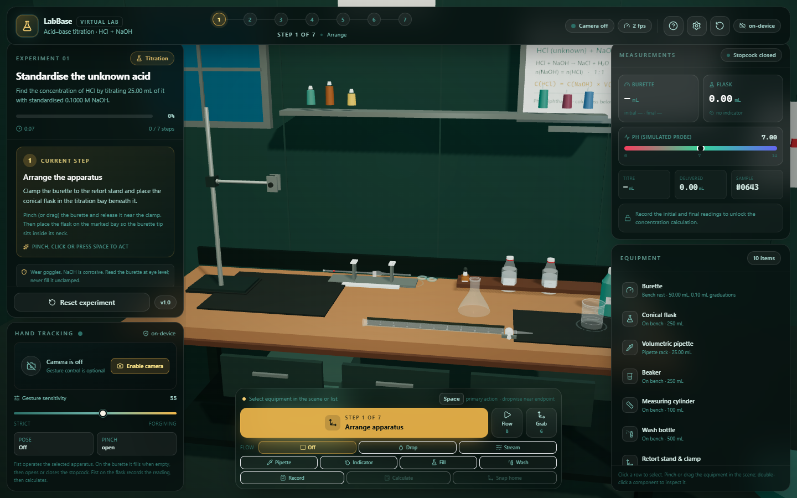
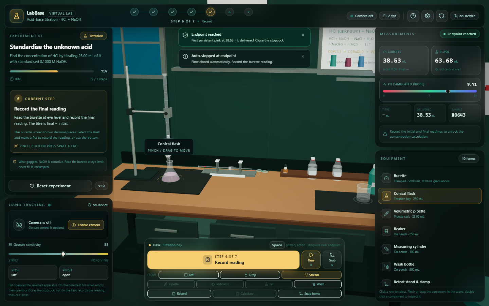
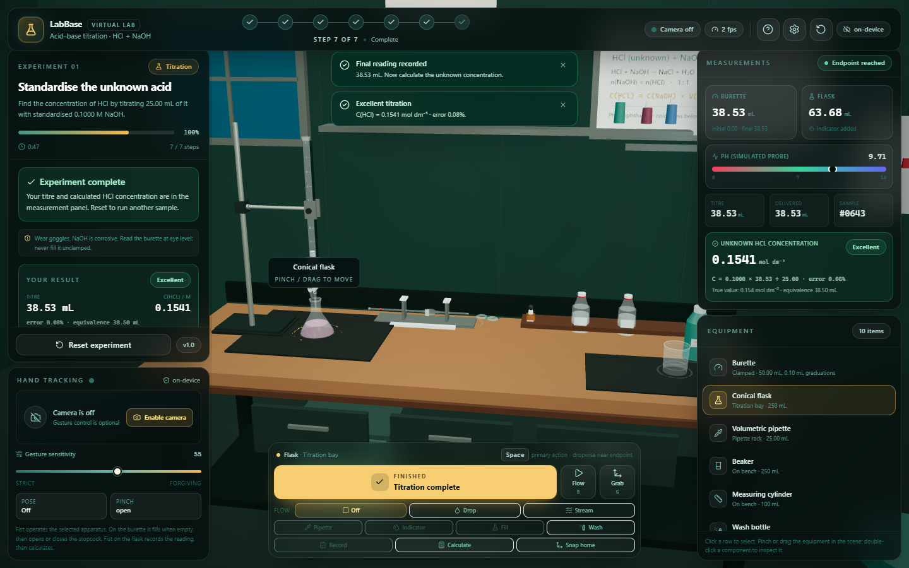

# LabBase — Virtual Titration Lab

A browser-based, gesture-controlled 3D chemistry laboratory. Students complete a strong acid–strong base
titration with MediaPipe hand tracking, or with mouse, keyboard and touch at any point.

**Experiment:** standardise an unknown HCl solution with 0.1000 M NaOH and phenolphthalein.
**Acceptance target:** a student completes the full titration with hand gestures, with fallback controls always available.



## Quick start

Requirements: Node.js 20.19+ or 22.12+ (24 recommended), a modern Chrome/Edge, and optionally a webcam.

```bash
pnpm install
pnpm dev
```

Open <http://127.0.0.1:5173>. Camera access requires `localhost` or HTTPS; frames are processed entirely in the browser.

Production build:

```bash
pnpm typecheck
pnpm test
pnpm build
pnpm preview
```

> The MediaPipe hand model (7.8 MB) and WASM runtime are self-hosted in `public/` so the lab works without a CDN.

## Run with Docker

The repository includes a multi-stage [Dockerfile](Dockerfile), an nginx configuration for the static build,
and a [docker-compose.yml](docker-compose.yml).

### Docker Compose (recommended)

```bash
docker compose up -d --build
```

Open **<http://localhost:8090>**. The default host port is **8090** because 8080 is commonly already occupied.
Use another port with an environment variable:

```bash
# bash / macOS / Linux
LABBASE_PORT=8091 docker compose up -d

# PowerShell
$env:LABBASE_PORT = "8091"; docker compose up -d
```

Useful commands:

```bash
docker compose ps                 # health/status
docker compose logs -f labbase    # nginx logs
docker compose down               # stop and remove the container/network
docker compose up -d --build      # rebuild after source changes
```

### Docker only

```bash
docker build -t labbase .
docker run -d --rm --name labbase -p 8090:80 labbase
```

Open <http://localhost:8090>. Stop it with `docker rm -f labbase`.

### What the container provides

- Multi-stage build: Node 24 + pnpm build, then an 83 MB nginx runtime image.
- Static production assets from `dist/`, with an SPA fallback for unknown paths.
- `/healthz` endpoint used by the Docker/Compose health check.
- Long-lived caching for hashed `/assets/` and the self-hosted MediaPipe files; `index.html` is `no-cache`.
- `application/wasm` MIME for the MediaPipe runtime and gzip for text assets.
- Security headers, including `Permissions-Policy: camera=(self)` so same-origin hand tracking works.
- No webcam passthrough is required: the browser owns the camera and only static files are served.

**Camera note:** use `http://localhost:8090` or `http://127.0.0.1:8090`; both are secure contexts in Chrome/Edge.
If you deploy on a LAN IP or domain, put the container behind HTTPS (for example a reverse proxy with TLS),
otherwise browsers will block `getUserMedia`.

## Why this is not a WonderSnap clone

WonderSnap is a particle experience. LabBase keeps only its interaction craft — MediaPipe lifecycle, rotation-invariant
finger ratios, pose debouncing, primary/secondary hand selection, wrist roll, sensitivity presets and the
"everything works without a camera" philosophy. The particle renderer, transform-feedback physics, model catalogue and
visual language are not used.

LabBase adds a solid 3D lab, snap-constrained apparatus, a Rapier rigid-body layer, an authoritative chemistry and
liquid-volume engine, a seven-step titration workflow and automated tests. See [ARCHITECTURE.md](docs/ARCHITECTURE.md)
for the full comparison.

## What is in the lab

- **Workbench** with a titration mat, bench slots and clamp/bay markers.
- **50 mL burette** with stopcock, graduation scale and live liquid column.
- **250 mL conical flask** with lathe-built glass and a liquid whose colour is derived from pH.
- **25 mL volumetric pipette** in a rack, **250 mL beaker**, **100 mL measuring cylinder**, **wash bottle**.
- **Retort stand and clamp**, **NaOH / unknown HCl bottles**, **phenolphthalein dropper**.
- **Safety equipment**: goggles, eyewash/first-aid wall station, fire extinguisher.
- Solid meshes with raycast hit proxies; no particle-only apparatus.

## Controls

### Gestures

| Gesture | Action |
|---|---|
| **Pinch** (thumb + index) | Grab the apparatus under the hand cursor. While held, move the hand to carry it. Pinch assist tolerates brief tracking dropouts and slightly missed targets. If your hand needs it, use **Calibrate** in the camera panel. |
| **Open hand** | Release. The apparatus snaps to the nearest compatible clamp, bay or bench pose. |
| **Point** (index only) | Dwell to select apparatus, or dwell on a highlighted UI control to activate it. |
| **Fist** | Operate the selection: fill the burette, open/close the stopcock, pipette the aliquot, add indicator, wash, record reading, calculate. |
| **Wrist twist** | Rotate a held or selected apparatus. |
| **Two hands** | Spread/close to zoom the view. |

Sensitivity is adjustable (0–100) in the camera panel and settings. **Pinch calibration** measures your own closed
pinch and widens the grab threshold for your hand and camera; use **Reset** to return to automatic thresholds.
Individual gestures can be disabled and the fist action can be configured in **Lab settings**.

### Mouse and touch

- Click to select; click the burette stopcock to open/close flow.
- Drag apparatus across the bench; release near the clamp or bay to snap.
- Double-click any component to inspect its description.
- Drag empty space to orbit, scroll to zoom.
- Touch: one-finger tap/drag, two-finger pinch zoom.

### Keyboard

| Keys | Action |
|---|---|
| `Space` / `Enter` | Context action: arrange → pipette → indicator → fill → flow → record → calculate |
| `E` | Inspect selected equipment |
| `G` | Grab / place selected equipment |
| `S` | Snap selected equipment to its lab position |
| `Q` / `Shift+Q` | Cycle equipment |
| Arrows | Move held apparatus 3 cm |
| `[` / `]` | Rotate 15° |
| `B` | Open/close stopcock |
| `1` / `2` / `3` | Flow off / dropwise / stream |
| `P` / `I` / `F` / `W` | Pipette / indicator / fill / wash |
| `N` | Record final reading |
| `C` | Start/stop camera |
| `Esc` | Cancel drag, close dialog, deselect |
| `Shift+R` | Reset experiment |

## The titration

1. **Arrange** — clamp the burette and place the flask in the bay. (Drag or use `S` / primary action.)
2. **Transfer analyte** — pipette 25.00 mL of unknown HCl into the flask.
3. **Indicator** — add 3 drops (0.15 mL) of phenolphthalein.
4. **Fill burette** — 50.00 mL of 0.1000 M NaOH, initial reading 0.00 mL.
5. **Titrate** — stream, then dropwise, until the first persistent pale pink. Close the stopcock.
6. **Record** — final burette reading; titre = final − initial.
7. **Calculate** — `C(HCl) = C(NaOH) × V(titre) ÷ V(aliquot)`, graded by percentage error.

The chemistry engine is authoritative: every transfer goes through conservation-checked container functions. The
flask colour and liquid geometry are projections of state, not inputs to it.




## Architecture at a glance

```
React UI → Zustand → interaction/gesture controllers → domain engines
                               ↓
                     R3F scene + Rapier + liquid visuals
```

- `src/domain/` — chemistry, containers/volume conservation, titration workflow, placement, catalogue.
- `src/gestures/` — landmarks, classifier, debouncers, gesture engine.
- `src/tracking/` — camera error taxonomy, MediaPipe `HandTracker`, React binding.
- `src/interaction/` — manipulation state machine, actions, keyboard map.
- `src/store/` — lab, settings and render telemetry stores.
- `src/scene/` — room, bench, solid apparatus, liquid visuals, snap markers, physics, raycast controllers.
- `src/ui/` — HUD, experiment/equipment/measurement/camera panels, dock, help, settings, inspector.

Full proposal, state machine, WonderSnap reuse table and performance/testing criteria: **[docs/ARCHITECTURE.md](docs/ARCHITECTURE.md)**.

## Testing

```bash
pnpm test        # 101 Vitest tests
pnpm typecheck   # strict TypeScript
pnpm build       # production bundle
```

Coverage includes gesture classification/debouncing, realistic fist-like pinch detection, pinch calibration, tracking
dropout grace, selection, pick-up/release, movement, snapping, mouse/keyboard fallbacks, chemistry, liquid conservation
(400-step randomised sequence), camera permission/failure, and the complete seven-step workflow. See [docs/TESTING.md](docs/TESTING.md) for measured browser, camera and performance results.

Browser smoke scripts (Playwright Core + installed Chrome) live in `scripts/`; they cover the full mouse workflow,
synthetic gesture frames through the real gesture bridge, MediaPipe camera startup, camera denial, phone layout and
performance.

## Performance

Measured at 1280×800 on an AMD Radeon integrated GPU through ANGLE/D3D11: **~144 fps** at the Balanced preset,
**175 draw calls**, **12,116 triangles**, 9 textures. SwiftShader software rendering drops to 2–3 fps and the adaptive
governor automatically moves to the Performance preset. Quality presets adjust DPR, shadows, shadow map size, camera
resolution and hand-tracking frame skipping.

## Privacy and limitations

- Webcam frames and landmarks stay in the browser. There is no backend and no upload path; a test verifies that
  tracking performs no `fetch`.
- The MediaPipe model is bundled locally.
- Hand-gesture recognition is implemented and unit-tested on synthetic landmarks. In this build environment the
  MediaPipe camera pipeline and the complete gesture→raycast→grab/move/snap/operate path were verified in Chrome;
  a physical-hand pass on a real webcam remains the final human acceptance check (see [docs/ACCEPTANCE.md](docs/ACCEPTANCE.md)).
- Educational simplification: the pH probe is a simulated learning aid. Colour is visualised with a faint tint even
  before the endpoint so colourless solutions remain visible.

## Credits and license

- Code and original assets: **MIT** (see [LICENSE](LICENSE)).
- Interaction concepts inspired by [WonderSnap](https://github.com/AkbarSheikh-debug/wondersnap) (MIT, © Akbar Sheikh).
- Hand landmark model and MediaPipe Tasks Vision runtime (Apache-2.0).
- Built with React, TypeScript, Vite, Three.js, React Three Fiber, Drei, Rapier, Zustand, Tailwind CSS and MediaPipe.
- Full dependency and asset notices: [THIRD_PARTY_NOTICES.md](THIRD_PARTY_NOTICES.md).
