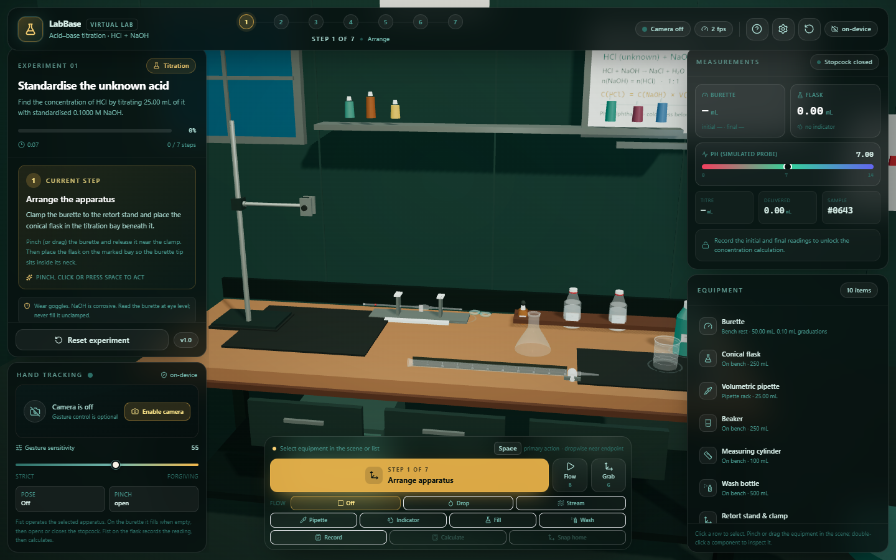
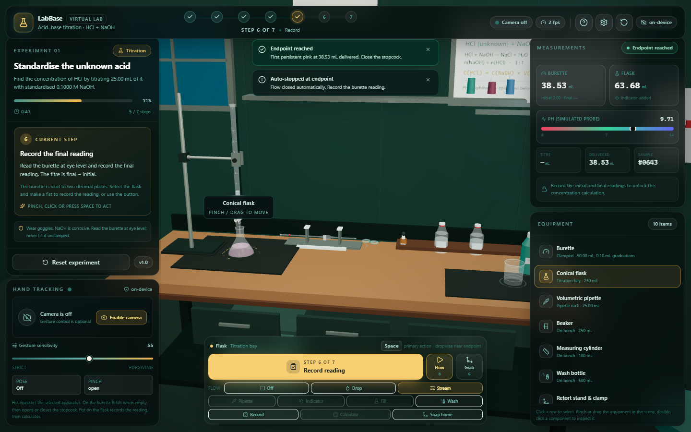
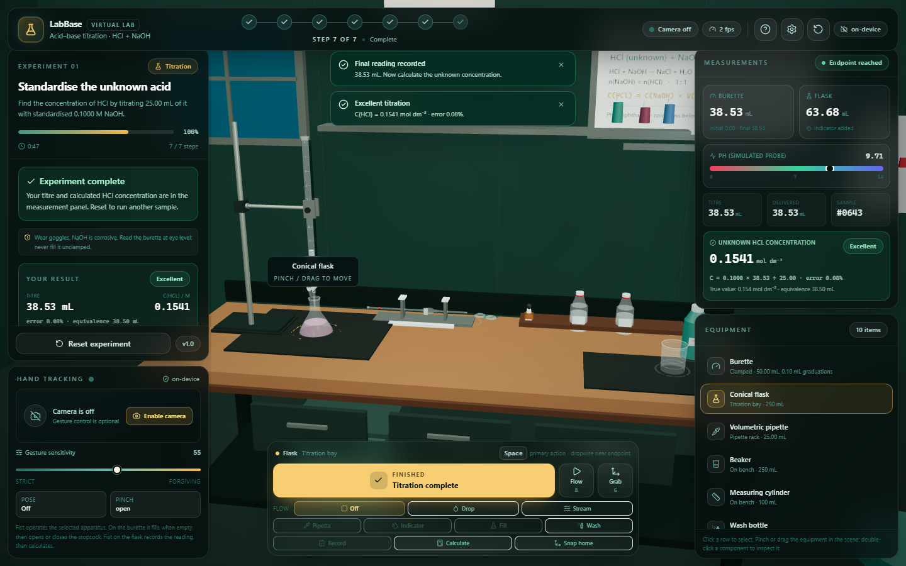

# Gesture Acceptance Walkthrough

This is the human acceptance test for the ultimate criterion:

> **A student completes a titration experiment using hand gestures, with the ability to switch to mouse and
> keyboard controls at any point.**

Use Chrome or Edge at `http://127.0.0.1:5173` (dev) or `http://127.0.0.1:4173` (preview). Camera access requires
localhost/HTTPS. No VR headset is used.

## Before you start

1. Sit about 50–80 cm from the webcam, with your hand inside the camera frame.
2. Click **Enable camera** in the Hand tracking panel and allow permission.
3. Wait for **Camera live**. Raise one hand; a ring cursor follows it.
4. If gestures feel strict, raise **Gesture sensitivity** towards Forgiving.
5. Pinch thumb and index together. The **Pinch** card shows the live gap and threshold. If a pinch is not recognised,
   click **Calibrate** in the camera panel, hold a firm pinch for ~2.5 seconds, then try again. **Reset** restores
   automatic thresholds.
6. Point with the index finger and hold still for ~0.55 s to click/select.

Expected status: hand count ≥ 1, a pose label such as `open`/`point`/`fist`, and a visible cursor ring.

## Pure-gesture acceptance sequence

| # | Gesture | Where | Expected result |
|---|---|---|---|
| 1 | **Point** + dwell | Burette on the bench (or its row in the equipment list) | Burette is selected; amber halo and label appear |
| 2 | **Pinch**, move, **open hand** | Burette tube → near the retort clamp | Burette snaps vertically into the clamp; the app says “Burette clamped” / arrangement progress updates |
| 3 | **Point** + dwell, **pinch**, move, **open** | Flask → amber titration-bay marker | Flask snaps into the bay under the burette tip |
| 4 | **Point** + dwell, then **fist** | Pipette in its rack (or equipment row) | 25.00 mL of unknown HCl is delivered; step 2 completes |
| 5 | **Point** + dwell, then **fist** | Phenolphthalein dropper | 3 drops (0.15 mL) added; the acidic solution stays colourless |
| 6 | **Point** + dwell, then **fist** | Clamped burette | Burette fills with 50.00 mL NaOH; initial reading 0.00 mL |
| 7 | **Fist** | Burette still selected | Stream starts. (Fist is an edge: close the hand once, then open it.) |
| 8 | **Point** + dwell | **Drop** button in the action dock | Flow switches to dropwise before the endpoint |
| 9 | **Fist**, or point-dwell **Off** | Burette / dock | Flow stops at the first **persistent pale pink** |
| 10 | **Point** + dwell, then **fist** | Flask | Final burette reading is recorded; step 6 completes |
| 11 | **Fist** again | Flask | Unknown concentration is calculated and graded |

**Expected result:** a titre near the equivalence volume, a calculated HCl concentration of about
0.08–0.16 mol dm⁻³, and a grade of Excellent/Good. For a 25.00 mL aliquot of ~0.100 M HCl, the endpoint is near
25 mL of 0.1000 M NaOH.

**All 11 actions above can be performed with gestures alone.** Point-dwell can activate any highlighted UI control
(camera/flow/record/calculate), and pinch/open handle all movement and snapping.

### If a gesture is missed

- Keep the hand fully in frame and use deliberate, slower poses.
- Hold the point pose for the full dwell; move the cursor off and back to re-arm.
- For pinch: make the thumb/index contact clearly in front of the palm (not a fist), and run **Pinch calibration**.
- A short tracking flicker will not drop the object; pinch assist holds it for ~320 ms.
- Increase sensitivity or disable a conflicting gesture in settings.
- Use the fallback at any time (below) without losing experiment state.

## Switching to mouse / keyboard mid-experiment

At any point:

- Click equipment to select; drag to move; click the stopcock; double-click to inspect.
- Press `Space` for the context action, `B` for stopcock, `G` to grab, arrows to move, `S` to snap home,
  `P`/`I`/`F` for pipette/indicator/fill, `N` to record.
- Touch: tap to select, drag with one finger, pinch with two fingers to zoom.

All experiment state (volumes, readings, endpoint, progress) lives in the domain store and is unaffected by the
input mode. There is no “gesture-only” mode to leave.

## Camera failure acceptance

Deny camera permission (or block the camera) and click **Enable camera**:

- A failure card names the problem and explains how to fix it.
- **Retry** attempts camera access again.
- **Continue without camera** closes the failure and leaves the mouse/keyboard/touch lab fully usable.
- No experiment action is blocked by camera failure.

## Validation status

- MediaPipe camera startup, local inference, status display and denial/fallback were verified in Chrome (see
  [TESTING.md](TESTING.md)).
- Gesture classification/debouncing and the full gesture→raycast→grab/rotate/snap/fist path were verified with
  synthetic landmarks and synthetic frames through the real gesture bridge.
- A **physical-hand** pass of every gesture, in your lighting and camera, is the remaining human check. If any gesture
  misclassifies, adjust sensitivity and record the result before shipping to students.

## Screenshots

